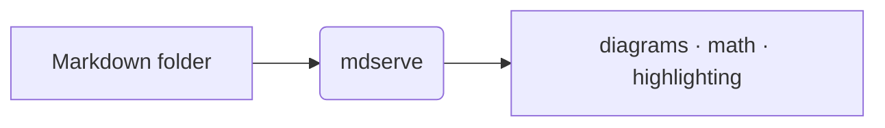

#  mdserve

A tiny, **zero-dependency** Markdown docs server. Point it at a directory of
`.md` files and browse them as HTML with a live left-nav; or render them to a
static site. One static Go binary, pure standard library — no third-party
modules.

## Great for

- **Reading what an LLM wrote.** Ask Claude/ChatGPT for a design doc, spec, or
  research write-up, save the Markdown into a folder, then `mdserve` it — read
  the result as a clean, zoomable page with a live outline and in-page find,
  instead of scrolling raw text in a chat window.
- **Browsing a repo's `docs/` offline** — tables, Mermaid diagrams, KaTeX math
  and syntax-highlighted code all render with no build step and no network.
- **Reviewing generated notes & reports** — plans, postmortems, meeting notes,
  anything you keep as `.md`, in a calm PDF-like reading view.
- **Publishing** a folder of Markdown as a self-contained, offline static site
  with `mdserve build`.

## Screenshots

Three built-in themes — one toolbar button cycles them:

| Dark (default) | Light | Warm |
|:--:|:--:|:--:|
|  |  |  |

## Features

A single-page Markdown reader: Markdown renders in the browser and the whole
front-end bundle is embedded, so it works **fully offline** — no CDN, no
network.

- **Reads the current directory** — a bare `mdserve` serves the folder you're
  standing in (free-port fallback if `127.0.0.1:8080` is taken, race-free via
  `net.Listen` on `:0`).
- **PDF-like reading view** — a centered page you can zoom (buttons, `Ctrl ±`,
  or `Ctrl`+wheel anchored at the cursor) and pan with the hand tool.
- **Three themes** — dark (default), light, warm; one button cycles them.
- **Folder tree + filter** — collapsible directories with Google Material
  Symbols file/folder icons; the `/` key jumps to the filter box.
- **Collapsible, resizable rails** — the file sidebar (`Cmd/Ctrl B`) and the
  outline (`` Cmd/Ctrl \ ``); widths and state persist in `localStorage`.
- **Auto outline** — a heading navigator with scroll-spy on the right.
- **In-page find** — `Cmd/Ctrl F`, highlight and step through matches.
- **Rich content** — GFM tables & task lists, syntax highlighting (highlight.js),
  Mermaid diagrams, and KaTeX math (currency-safe), all from the embedded bundle.
- **Right-to-left ready** — any RTL script (Arabic, Persian, Hebrew, …) renders
  RTL automatically, per block — including the file tree, outline, and
  breadcrumb. Arabic & Persian ship embedded fonts; other scripts use the system
  font. Mixes with English, fully offline.
- **Remembers where you were** — per-doc scroll position is restored.
- **Live-reload** — the page polls for `.md` changes and re-renders in place.
- **Browser auto-open** (`--open`); a **colorized, columnar request log**
  (time · status · method · duration · path).
- **Static build** — `mdserve build` renders a self-contained, offline HTML
  tree (the vendor bundle is copied alongside).
- Path-traversal-safe; serves only `.md` under the configured root.

## Rich content, rendered offline

Docs render from the embedded vendor bundle — no CDN, no network, no build step:

- **Syntax highlighting** — fenced code blocks via highlight.js, with a real
  dark theme in dark mode.
- **Mermaid diagrams** — fence a block as ` ```mermaid `.
- **KaTeX math** — inline `$…$` and display `$$…$$`. Prices like `$100` stay as
  text, so finance/crypto docs aren't mangled into math.
- **GFM** — tables, task lists, strikethrough, and autolinks.
- **Right-to-left** — any RTL script (Arabic, Persian, Hebrew, …) flips to RTL
  automatically; each block picks its own direction, so LTR and RTL can mix in
  one doc, and the file tree, outline, and breadcrumb follow suit. Arabic &
  Persian use the embedded **Vazirmatn** (serif) / **Noto Sans Arabic** (sans)
  faces; other RTL scripts use the system font. Fenced code stays left-to-right.
- **Local images & assets** referenced by a doc are served too, and copied into
  the static build.

````markdown


Euler's identity, inline: $e^{i\pi} + 1 = 0$
````

## Install

No toolchain needed — grab a prebuilt binary:

```sh
curl -fsSL https://raw.githubusercontent.com/mostafa-re/mdserve/main/scripts/install.sh | sh
```

Detects your OS/arch and installs to `~/.local/bin`, and adds that dir to your
`PATH` (in your shell rc) when it isn't already there — no root needed. Override
the version or dir with `MDSERVE_VERSION` / `MDSERVE_BINDIR`; skip the PATH edit
with `MDSERVE_NO_MODIFY_PATH`.

### Releases

Every `vX.Y.Z` tag ships prebuilt archives — **macOS, Linux, Windows ×
amd64/arm64**, each with a SHA-256 sum — on the
[releases page](https://github.com/mostafa-re/mdserve/releases). Download the one
for your platform, unpack it, and put `mdserve` (or `mdserve.exe`) on your
`PATH`; on Windows use the `.zip`.

| OS | Arch | Asset |
|---|---|---|
| macOS | Apple Silicon | `mdserve_<tag>_darwin_arm64.tar.gz` |
| macOS | Intel | `mdserve_<tag>_darwin_amd64.tar.gz` |
| Linux | x86-64 | `mdserve_<tag>_linux_amd64.tar.gz` |
| Linux | ARM64 | `mdserve_<tag>_linux_arm64.tar.gz` |
| Windows | x86-64 | `mdserve_<tag>_windows_amd64.zip` |
| Windows | ARM64 | `mdserve_<tag>_windows_arm64.zip` |

### Update

```sh
mdserve update          # replace the running binary with the latest release
mdserve update --check  # only report whether a newer release exists
mdserve version         # release tag, or dev+<commit> for a source build
```

`mdserve version` and the serve startup banner print a release indicator next to
the version — a green `● latest` when you're up to date, or a yellow `● update
available: vX.Y.Z` (with the update command) when a newer release exists. The
check runs only for release builds, caches its result for ~24h, and fails
silently — so it never gets in the way of the offline-first workflow. Turn it off
with `--no-update-check` (serve) or `MDSERVE_NO_UPDATE_CHECK`.

<details><summary>Build from source (needs Go)</summary>

```sh
go install github.com/mostafa-re/mdserve@latest
```

</details>

## Usage

```sh
mdserve                                         # serve the current dir at 127.0.0.1:8080
mdserve serve --dir docs --open                 # serve, free-port, open browser
mdserve serve --dir docs --addr :9000           # fixed port
mdserve build --dir docs --out site             # static HTML tree
mdserve serve --dir docs --default-doc plan/README.md   # custom landing doc
mdserve serve --exclude node_modules --exclude "*.private.md"  # hide paths
```

| flag | default | notes |
|---|---|---|
| `--dir` | `.` | directory of `.md` files (defaults to the current dir) |
| `--addr` | `127.0.0.1:8080` | loopback only; falls back to a free port if taken |
| `--default-doc` | `README.md` | doc opened at `/` |
| `--exclude` | — | glob(s) to hide dirs/files; repeatable & comma-separated |
| `--allow-host` | — | additional exact hostname/IP for custom access; repeatable, no port |
| `--open` | off | open the browser |
| `--no-reload` | off | disable live-reload polling (serve) |
| `--no-update-check` | off | skip the launch-time release check (serve) |
| `--no-cdn` | off | deprecated — assets are always embedded (no-op) |
| `--out` | — | output dir (build, required) |

`--exclude` hides matching paths from the nav, direct URLs, and the static
build, including descendants of excluded directories. Matching is
case-insensitive. Hidden path segments (such as `.env` and `.git`) and `_site`
are blocked by default across requests, indexing, polling, and export inputs.
Symlinks beneath the document root are rejected, including links to files inside
that root. The explicitly configured root may itself be a symlink: its directory
is opened once and remains anchored even if that symlink is changed later.

File URLs must use slash-separated relative paths without `.` or `..` segments.
Backslashes, colons (including Windows drive names and alternate data streams),
and segments ending in dots or spaces are rejected on every platform. Ordinary
Markdown, images, and local assets remain supported. This policy does not isolate
hard-linked files or mounted filesystems; choose a document root containing only
files you intend to share.

HTTP requests must use `localhost`, `127.0.0.1`, `::1`, the concrete bound IP,
or an exact name configured with `--allow-host`, at the actual listening port
(including free-port fallback). Wildcard listeners such as `--addr :9000` still
require explicit hostnames/IPs for LAN access: for example, add
`--allow-host 192.168.1.10 --allow-host docs.example`. No authentication is added.
Browser Origin headers must match the request origin exactly; missing Origin
headers are accepted for navigation and command-line clients. Cross-site and
same-site Fetch Metadata requests are rejected. Only GET and HEAD are supported;
no CORS access is granted. Reverse proxies must preserve these host/origin rules.

## Design

One static Go binary, **zero third-party dependencies** — pure standard library.
Markdown is rendered client-side by marked.js; the file tree (`/api/tree`), file
contents (`/raw`), and change polling (`/api/poll`) are tiny JSON/text endpoints.
The front-end vendor bundle — marked, highlight.js, Mermaid, KaTeX (+ its fonts)
— is embedded with `go:embed` and served from `/vendor/`, so both the live
reader and the static build work with no network. Live-reload is an mtime poll,
so behavior is identical across OSes. The static build pre-renders Markdown with
a small, self-contained renderer (a GFM subset) in `internal/markdown`.

The code is a thin `main` (CLI, version, self-update) over `internal/` packages:
`server` (HTTP endpoints + static build), `web` (the embedded reader UI and
vendor bundle), `markdown` (the static-build renderer), and `ansi` (terminal
coloring).

## Use in a project

A Makefile target that shells out to the installed binary:

```make
doc:        ## Serve docs/ as HTML (free port, opens browser)
	@mdserve serve --dir docs --default-doc README.md --open
doc-build:  ## Render docs/ to docs/_site/
	@mdserve build --dir docs --out docs/_site
```

> **Local docs only.** mdserve has no auth and renders raw repo Markdown; it
> binds for local browsing. Never run it as a public/deployed service.

## Development

```sh
make build              # build ./bin/mdserve (version stamped from git)
make install            # go install, version-stamped
make run                # build + serve the current dir, open the browser
make test               # run the suite
make                    # list all targets
```

## License

[MIT](LICENSE).
