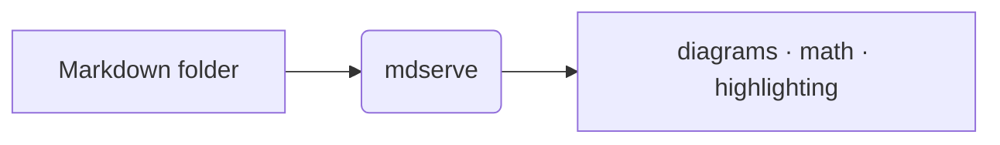

#  mdserve

A tiny, **zero-dependency** Markdown docs server. Point it at a directory of
`.md` files and browse them as HTML with a live left-nav; or render them to a
static site. One static Go binary, pure standard library — no third-party
modules.

## Great for

- **Reading what an LLM wrote.** Ask Claude/ChatGPT for a design doc, spec, or
  research write-up, save the Markdown into a folder, then `mdserve` it — read
  the result as a clean, zoomable page with a live outline and in-page find,
  instead of scrolling raw text in a chat window.
- **Browsing a repo's `docs/` offline** — tables, Mermaid diagrams, KaTeX math
  and syntax-highlighted code all render with no build step and no network.
- **Reviewing generated notes & reports** — plans, postmortems, meeting notes,
  anything you keep as `.md`, in a calm PDF-like reading view.
- **Publishing** a folder of Markdown as a self-contained, offline static site
  with `mdserve build`.

## Screenshots

Three built-in themes — one toolbar button cycles them:

| Dark (default) | Light | Warm |
|:--:|:--:|:--:|
|  |  |  |

## Features

A single-page Markdown reader: Markdown renders in the browser and the whole
front-end bundle is embedded, so local-only documents work **offline** without
a CDN. Remote document images and release checks can still use the network.

- **Reads the current directory** — a bare `mdserve` serves the folder you're
  standing in (free-port fallback if `127.0.0.1:8080` is taken, race-free via
  `net.Listen` on `:0`).
- **PDF-like reading view** — a centered page you can zoom (buttons, `Ctrl ±`,
  or `Ctrl`+wheel anchored at the cursor) and pan with the hand tool.
- **Three themes** — dark (default), light, warm; one button cycles them.
- **Folder tree + filter** — collapsible directories with Google Material
  Symbols file/folder icons; the `/` key jumps to the filter box.
- **Collapsible, resizable rails** — the file sidebar (`Cmd/Ctrl B`) and the
  outline (`` Cmd/Ctrl \ ``); widths and state persist in `localStorage`.
- **Auto outline** — a heading navigator with scroll-spy on the right.
- **In-page find** — `Cmd/Ctrl F`, highlight and step through matches.
- **Rich content** — GFM tables & task lists, syntax highlighting (highlight.js),
  Mermaid diagrams, and KaTeX math (currency-safe), all from the embedded bundle.
- **Right-to-left ready** — any RTL script (Arabic, Persian, Hebrew, …) renders
  RTL automatically, per block — including the file tree, outline, and
  breadcrumb. Arabic & Persian ship embedded fonts; other scripts use the system
  font. Mixes with English, fully offline.
- **Remembers where you were** — per-doc scroll position is restored.
- **Live-reload** — the page polls for `.md` changes and re-renders in place.
- **Browser auto-open** (`--open`); a **colorized, columnar request log**
  (time · status · method · duration · path).
- **Static build** — `mdserve build` renders a self-contained, offline HTML
  tree (the vendor bundle is copied alongside).
- Rooted file access with hidden-path, exclusion, symlink, Host and Origin checks.
  Markdown and permitted local assets are served beneath the configured root.

## Rich content, rendered offline

Docs render from the embedded vendor bundle — no CDN or build step:

- **Syntax highlighting** — fenced code blocks via highlight.js, with a real
  dark theme in dark mode.
- **Mermaid diagrams** — fence a block as ` ```mermaid `.
- **KaTeX math** — inline `$…$` and display `$$…$$`. Prices like `$100` stay as
  text, so finance/crypto docs aren't mangled into math.
- **GFM** — tables, task lists, strikethrough, and autolinks.
- **Right-to-left** — any RTL script (Arabic, Persian, Hebrew, …) flips to RTL
  automatically; each block picks its own direction, so LTR and RTL can mix in
  one doc, and the file tree, outline, and breadcrumb follow suit. Arabic &
  Persian use the embedded **Vazirmatn** (serif) / **Noto Sans Arabic** (sans)
  faces; other RTL scripts use the system font. Fenced code stays left-to-right.
- **Local images & assets** referenced by a doc are served too. Static builds
  copy permitted referenced images alongside the pages.

````markdown


Euler's identity, inline: $e^{i\pi} + 1 = 0$
````

## Install

No toolchain needed — download an installer at a pinned release tag, inspect it,
then run it. Select the tag you intend to install from the
[releases page](https://github.com/mostafa-re/mdserve/releases):

```sh
release_tag=vX.Y.Z  # replace with a release containing the verified installer
curl --proto '=https' --proto-redir '=https' -fsSL \
  "https://raw.githubusercontent.com/mostafa-re/mdserve/$release_tag/scripts/install.sh" \
  -o install-mdserve.sh
less install-mdserve.sh
MDSERVE_VERSION="$release_tag" sh install-mdserve.sh
```

Use a release containing the verified installer described here; older pinned
scripts may lack these checks. Inspecting the script matters before running it.
The installer detects macOS/Linux and amd64/arm64, verifies the matching per-asset
`.sha256` record, and extracts only the expected regular `mdserve` entry. It stages
the binary in the installation directory and renames it into place after success.
No root is needed. `MDSERVE_BINDIR` selects an absolute install directory (no colon);
`MDSERVE_NO_MODIFY_PATH=1` skips shell profile edits. Custom paths are quoted as
shell data when writing configuration for sh/bash/zsh/fish.

Both installer and updater fail closed on missing/malformed/mismatched checksums,
unsafe entry paths, links and extra archive entries. The Go updater limits archives
to 64 MiB, binaries to 128 MiB, and checksum records to 4 KiB. Unix replacement is
atomic; Windows moves the old executable to a unique backup and restores it if
replacement fails. If rollback also fails, the diagnostic identifies the retained
backup. Checksums from the same GitHub release detect corruption; they do not
independently authenticate a compromised release and are not signatures.

For manual verification, download the chosen archive and its `.sha256` file from
the same release. Inspect the checksum file: it must contain exactly one 64-digit
SHA-256 digest and the exact archive filename. Before extracting, compare it with:

```sh
sha256sum mdserve_v0.7.0_darwin_arm64.tar.gz
# macOS alternative:
shasum -a 256 mdserve_v0.7.0_darwin_arm64.tar.gz
```

Stop on a mismatch. Inspect `tar -tzf ARCHIVE` and `tar -tvzf ARCHIVE`: the only entry
must be the regular file `mdserve`. For a Windows ZIP, inspect the sole regular
`mdserve.exe` entry and compare `(Get-FileHash ARCHIVE -Algorithm SHA256).Hash` in
PowerShell with the downloaded digest. Keep the existing executable until all
verification and extraction steps succeed.

### Releases

Every `vX.Y.Z` tag ships prebuilt archives — **macOS, Linux, Windows ×
amd64/arm64**, each with a SHA-256 sum — on the
[releases page](https://github.com/mostafa-re/mdserve/releases). Download the one
for your platform, unpack it, and put `mdserve` (or `mdserve.exe`) on your
`PATH`; on Windows use the `.zip`.

| OS | Arch | Asset |
|---|---|---|
| macOS | Apple Silicon | `mdserve_<tag>_darwin_arm64.tar.gz` |
| macOS | Intel | `mdserve_<tag>_darwin_amd64.tar.gz` |
| Linux | x86-64 | `mdserve_<tag>_linux_amd64.tar.gz` |
| Linux | ARM64 | `mdserve_<tag>_linux_arm64.tar.gz` |
| Windows | x86-64 | `mdserve_<tag>_windows_amd64.zip` |
| Windows | ARM64 | `mdserve_<tag>_windows_arm64.zip` |

### Update

```sh
mdserve update          # replace the running binary with the latest release
mdserve update --check  # only report whether a newer release exists
mdserve version         # release tag, or dev+<commit> for a source build
```

`mdserve version` and the serve startup banner print a release indicator next to
the version — a green `● latest` when you're up to date, or a yellow `● update
available: vX.Y.Z` (with the update command) when a newer release exists. The
check runs only for release builds, caches its result for ~24h, and fails
silently — so it never gets in the way of the offline-first workflow. Turn it off
with `--no-update-check` (serve) or `MDSERVE_NO_UPDATE_CHECK`.

<details><summary>Build from source (needs Go)</summary>

```sh
go install github.com/mostafa-re/mdserve@latest
```

</details>

## Usage

```sh
mdserve                                         # serve the current dir at 127.0.0.1:8080
mdserve serve --dir docs --open                 # serve, free-port, open browser
mdserve serve --dir docs --addr :9000           # fixed port
mdserve build --dir docs --out site             # static HTML tree
mdserve serve --dir docs --default-doc plan/README.md   # custom landing doc
mdserve serve --exclude node_modules --exclude "*.private.md"  # hide paths
```

| flag | default | notes |
|---|---|---|
| `--dir` | `.` | directory of `.md` files (defaults to the current dir) |
| `--addr` | `127.0.0.1:8080` | loopback only; falls back to a free port if taken |
| `--default-doc` | `README.md` | doc opened at `/` |
| `--exclude` | — | glob(s) to hide dirs/files; repeatable & comma-separated |
| `--allow-host` | — | additional exact hostname/IP for custom access; repeatable, no port |
| `--open` | off | open the browser |
| `--no-reload` | off | disable live-reload polling (serve) |
| `--no-update-check` | off | skip the launch-time release check (serve) |
| `--no-cdn` | off | deprecated — assets are always embedded (no-op) |
| `--out` | — | output dir (build, required) |

`--exclude` hides matching paths from the nav, direct URLs, and the static
build, including descendants of excluded directories. Matching is
case-insensitive. Hidden path segments (such as `.env` and `.git`) and `_site`
are blocked by default across requests, indexing, polling, and export inputs.
Symlinks beneath the document root are rejected, including links to files inside
that root. The explicitly configured root may itself be a symlink: its directory
is opened once and remains anchored even if that symlink is changed later.

File URLs must use slash-separated relative paths without `.` or `..` segments.
Backslashes, colons (including Windows drive names and alternate data streams),
and segments ending in dots or spaces are rejected on every platform. Ordinary
Markdown, images, and local assets remain supported. This policy does not isolate
hard-linked files or mounted filesystems; choose a document root containing only
files you intend to share.

HTTP requests must use `localhost`, `127.0.0.1`, `::1`, the concrete bound IP,
or an exact name configured with `--allow-host`, at the actual listening port
(including free-port fallback). Wildcard listeners such as `--addr :9000` still
require explicit hostnames/IPs for LAN access: for example, add
`--allow-host 192.168.1.10 --allow-host docs.example`. No authentication is added.
Browser Origin headers must match the request origin exactly; missing Origin
headers are accepted for navigation and command-line clients. Cross-site and
same-site Fetch Metadata requests are rejected. Only GET and HEAD are supported;
no CORS access is granted. Reverse proxies must preserve these host/origin rules.

Rendered Markdown is sanitized with the locally bundled DOMPurify before DOM
insertion in both live and static modes. Supported formatting remains; scripts,
event handlers, raw SVG/MathML, embedded frames/objects, forms, and document
styles are removed. Task checkboxes are disabled. Mermaid uses strict security,
text labels, sanitized SVG output, and no document-controlled callbacks.
Static pages require JavaScript to sanitize their inert rendered source before
displaying it; they work offline with the copied vendor bundle.

The reader uses a hash-based script Content Security Policy without inline-script
or eval permission; inline styles remain permitted for math and diagrams. Live
raw/asset responses have a restrictive sandbox policy to prevent standalone
HTML/SVG from becoming executable reader-origin pages. Static export assets
follow the image policy below.

Static export copies only local images referenced by quoted `src`/`href` values
in rendered documents: PNG, JPEG, GIF, WebP, AVIF, ICO, and restricted SVG.
SVG must contain only basic drawing/text primitives and permitted attributes;
scripts, styles, links, external resources, animation and foreign markup fail the
build. Hidden, excluded and symlink inputs remain blocked. Unsupported or missing
assets are skipped with diagnostics; Markdown links retain their generated targets.
Unrelated files, HTML, scripts, stylesheets and arbitrary downloads are not copied.
The `vendor/` namespace is reserved for the embedded bundle.

The output must be absent or empty, outside the source tree, with an existing
parent and no destination symlinks. A private sibling directory is populated
through rooted writes and renamed into place after success. Existing exports must
be removed or a new output directory selected before rebuilding. Failed builds
leave source files and existing output contents intact. Exported documents may
still reference remote images; inspect the intended documents before publishing.

Embedded libraries and fonts need no network. Documents may still reference
remote HTTP/HTTPS images and links; remote images remain allowed by design and
can contact their hosts. Choose trusted documents when external resource privacy
matters.

## Design

One static Go binary, **zero third-party dependencies** — pure standard library.
Markdown is rendered client-side by marked.js; the file tree (`/api/tree`), file
contents (`/raw`), and change polling (`/api/poll`) are tiny JSON/text endpoints.
The front-end vendor bundle — marked, DOMPurify, highlight.js, Mermaid, KaTeX (+ its fonts)
— is embedded with `go:embed` and served from `/vendor/`, so both the live
reader and the static build render local-only documents without network access.
Live-reload is an mtime poll,
so behavior is identical across OSes. The static build pre-renders Markdown with
a small, self-contained renderer (a GFM subset) in `internal/markdown`.

The code is a thin `main` (CLI, version, self-update) over `internal/` packages:
`server` (HTTP endpoints + static build), `web` (the embedded reader UI and
vendor bundle), `markdown` (the static-build renderer), and `ansi` (terminal
coloring).

## Use in a project

A Makefile target that shells out to the installed binary:

```make
doc:        ## Serve docs/ as HTML (free port, opens browser)
	@mdserve serve --dir docs --default-doc README.md --open
doc-build:  ## Render docs/ to a fresh sibling docs-site/
	@mdserve build --dir docs --out docs-site
```

> **Local docs only.** mdserve has no authentication. Keep the default loopback
> bind and choose a root containing only shareable documents and assets. Host and
> Origin checks do not authorize users. Do not deploy the live server publicly.

## Development

```sh
make build              # build ./bin/mdserve (version stamped from git)
make install            # go install, version-stamped
make run                # build + serve the current dir, open the browser
make test               # run Go regressions, including dummy installer fixtures
make vet                # run Go static analysis
make                    # list all targets
```

Go 1.26 or newer is required. For the development-only browser suite, follow
[tests/browser/README.md](tests/browser/README.md). CI runs Go tests, race checks
and vet on Linux/macOS/Windows, plus live/static Chromium security and feature
checks on Linux. Installer tests use temporary HOME and install directories, not
your real profile or installed binary. Browser dependencies are absent from the
embedded application.

See [internal/web/VENDOR.md](internal/web/VENDOR.md) for bundled-library versions,
provenance and the dated advisory review. Sanitization and request checks do not
provide resource limits for arbitrary large or expensive documents. Source
validation does not prove that published binaries contain this source.

## License

[MIT](LICENSE).
