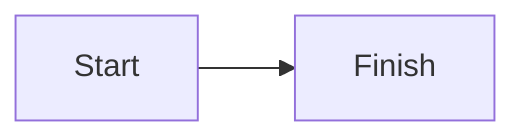

# Baseline compatibility fixture

English beside فارسی: راهنمای خواندن — URL https://example.invalid and `sample_code`.

## Formatting

**Bold**, *italic*, ~~deleted~~, [nested document](guide/intro.md), and a local image:


| English | فارسی |
| --- | --- |
| Value 123 | مقدار ۱۲۳ |

- [x] Complete task
- [ ] Pending task

```go
fmt.Println("hello")
```



Inline math $x^2$ and display math:

$$
E = mc^2
$$
